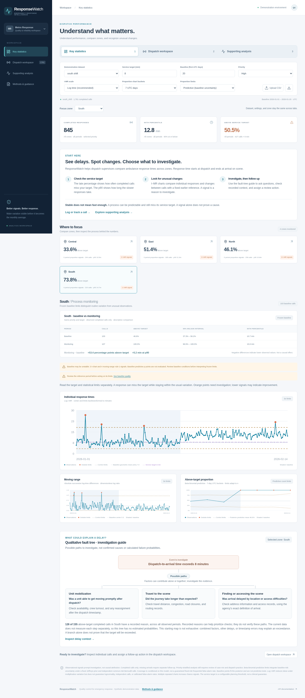

# ResponseWatch

[Live dashboard](https://responsewatch-lpj2.onrender.com) · [Public API](https://responsewatch-lpj2.onrender.com/docs) · [Judge walkthrough](docs/DEMO.md)

ResponseWatch helps ambulance dispatch supervisors investigate response-time variation, missed targets, and zones needing follow-up. It meets the assignment's React/Vite frontend requirement and provides both an installable Python statistical library and FastAPI REST API. No patient information is required. The eight-minute example target is illustrative, not a universal medical standard.



## What it does

- Log open dispatches, show elapsed/overdue counts, and validate arrivals before adding them to completed-call statistics.
- Compare baseline and monitoring late proportions, Wilson 95% intervals, and empirical p90 by zone and priority.
- Monitor individual log response times and moving ranges against frozen baseline limits.
- Use beta-binomial posterior predictive late-count limits, integrating baseline uncertainty with a stated Jeffreys Beta(0.5,0.5) prior. Retain exact-binomial plug-in limits for comparison.
- Show baseline quality diagnostics without certifying the reference as stable.
- Explore recorded delay reasons in Pareto order, annotation coverage, and unadjusted shift/traffic/available-unit strata. Associations are not causal explanations.
- Assign a review owner, action, status, and follow-up date. Browser-local mode works immediately; optional token-protected shared SQLite mode needs operator-provided persistent storage.
- Import/export CSV, retaining optional context columns, and export review backups.

## Find your way around

Shared dataset and analysis settings apply across three work tabs:

- **Key statistics** explains the tool's purpose and prioritizes the main performance measures, zone comparisons, and I-MR/predictive charts. A qualitative fault-tree guide organizes possible explanations to investigate; it does not calculate failure probabilities or establish causes.
- **Dispatch workspace** contains open-dispatch tracking, completed-call logging and records, calls outside the individual-chart limits, and resolution reviews. Select a completed call to compare its response with its zone's baseline limits and service target.
- **Supporting analysis** contains delay patterns, baseline-quality diagnostics, detailed period counts, and model information for closer investigation.

**Methods & guidance** remains available for statistical assumptions and interpretation. Switching work tabs changes the view, not the statistical calculations or selected dataset.

## Run locally

Use Python 3.11+ and Node.js 22.12+ (Python 3.12 and Node 24 were verified). From the repository root:

```sh
./scripts/install.sh
.venv/bin/python -m uvicorn responsewatch.api:app --host 0.0.0.0 --port 8000
```

Build before starting FastAPI: the server mounts the production frontend at startup. Open `http://localhost:8000`; API docs are at `/docs`. For frontend development, run `npm run dev` inside `frontend` while the API runs on port 8000. Vite proxies API/docs requests.

Manual installation is `python -m venv .venv`, `.venv/bin/pip install -r requirements.txt`, `.venv/bin/pip install --no-deps -e .`, then `npm ci && npm run build` in `frontend`. Dependency installation retains normal TLS verification. The setup script selects a writable npm cache for cloud environments.

## Python library and API

```python
import csv
from responsewatch import analyze

with open("datasets/south_shift.csv", newline="") as handle:
    records = list(csv.DictReader(handle))
report = analyze(records, target_minutes=8, baseline_days=20,
                 priority="high", imr_scale="log", aggregation_days=7,
                 p_method="beta_binomial")
south = next(z for z in report["zones"] if z["zone"] == "South")
print(south["comparison"])
```

`analyze` accepts 1–100,000 completed record dictionaries. Required fields are `id`, `zone`, `priority`, `dispatched_at`, and `arrived_at`. Optional fields include `delay_reason`, `shift`, `traffic`, and `units_available`. The target must be finite and positive; baseline days 1–3650; aggregation days 1–365; scale `log` or `raw`; model `beta_binomial` or `exact_binomial`. Library priority defaults to `all`; the UI defaults to `high`. Invalid records/settings raise `ValueError` or return HTTP 422 through the API.

`validate_records(records)` returns normalized copies ordered by dispatch and ID, with calculated minutes and internal `_dt` timestamps. Analysis returns overall/per-zone summaries, comparisons, I-MR/predictive chart points, baseline diagnostics, delay patterns and warnings. [API.md](docs/API.md) explains fields and provides a complete request/response example; `/docs` and `/openapi.json` provide typed nested contracts.

## Three realistic, reproducible demonstrations

Each CSV has 1,781 synthetic completed calls across four zones and 45 days, including 845 high-priority calls. Demand varies by zone, weekday/weekend and time of day; priority mix, traffic and available units vary. Scenarios share base draws, with a five-minute South deterioration or 0.72 duration multiplier after day 20. These are controlled fictional examples, not fitted ambulance-service models.

- [Dataset README](datasets/README.md): files, generator, distributions and assumptions.
- [Codebook](datasets/CODEBOOK.md): every variable, units, allowed values and collection source.
- [Collection protocol](docs/collection.md): clock synchronization, missing arrivals, exclusions and privacy.
- [Statistical methods](docs/methods.md): estimators, prior, assumptions, uncertainty and limitations.
- [Demo guide](docs/DEMO.md): expected outcomes and a presentation sequence.

Regenerate without touching tracked files: `python datasets/generate.py --output-dir /tmp/responsewatch-datasets`. With no output argument it refreshes the three bundled CSVs using seed 467.

## Validation and reproducibility

The [validation record](docs/VALIDATION.md) records local and public release checks. Tests include independently known probabilities, log I-MR, large counts, zero/all-late baselines, frozen reference periods, typed API parity, context denominators, dataset byte reproducibility, and protected review persistence/conflicts.

Run `.venv/bin/python -m pytest -q`. The [benchmark](benchmarks/README.md) compares predictive and plug-in limits with 200 runs per main scenario and prespecified sensitivity cases. Reproduce it with `.venv/bin/python scripts/benchmark.py --output /tmp/benchmark.json`. Results include Monte Carlo uncertainty and detection delay; no universal false-alarm guarantee is claimed.

CI installs pinned dependencies, runs statistical/API/dataset tests, regenerates CSVs in a temporary directory, builds React/Vite, and exercises the built application in Chromium. The browser script is `python scripts/browser_smoke.py --url http://127.0.0.1:8000 --browser auto` after installing Playwright 1.62.0 and its Chromium browser. The [GitHub CI run for this release](https://github.com/aaronk467/team-reliability/actions/runs/38975394899) passed the full pipeline.

## Deployment and storage limits

The committed Dockerfile and Render Blueprint serve the frontend and API together. See [deployment.md](docs/deployment.md) for reproduction and optional shared storage configuration. Statistical API version 0.3.0 from commit `de729ae` was verified publicly; analyses for all three datasets and both models exactly match the local library. The new three-tab interface is locally verified and requires deployment of the latest source. Verify the visible tabs and analysis results after interface deployments; the API version remains 0.3.0 because the statistical engine is unchanged.

Open dispatches and added completed calls remain browser-local and source-specific. Shared mode applies to resolution reviews, not the dispatch register. No authenticated agency-wide dispatch database, correction audit trail, background emergency notification, or clinical outcome model is supplied. Review notes should use synthetic/nonpersonal aliases and information. Free Render instance files are ephemeral; a configured SQLite path alone does not prove durable storage.

Completed-call denominators exclude unresolved/canceled/missing arrivals. Those exclusions can bias observed performance downward. Keep a complete external intake register and report open/excluded calls alongside these analyses. The tool supports quality investigation, not emergency dispatch control or causal/clinical decisions.
